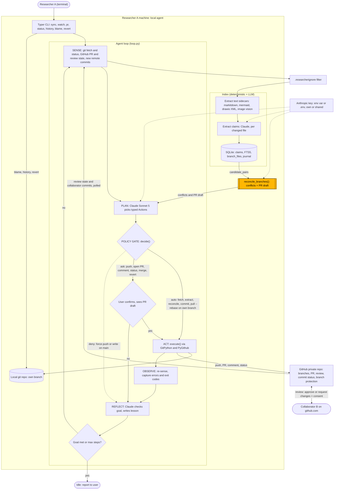

# researcher: plan

GitHub agent. Git + GitHub are the deterministic system; Claude senses, plans, acts, observes, reflects, repeats on top of it. Wrapper, not a new destination: collaboration stays on GitHub.

## 0. Decisions

| Decision | Value | Source |
|---|---|---|
| Problem | Two researchers collaborate on GitHub; agent runs git so they don't, flags cross-branch conflicts, drafts consent-seeking PRs | user |
| Product shape | Wrapper around Git + GitHub, no UI of its own | user |
| Repo | Greenfield, `~/researcher` | user ("create") |
| Language / CLI | Python 3.11+, Typer. FastAPI dropped (no HTTP server) | delegated + user-confirmed |
| Git remote / PR layer | GitHub, private repo; PR + required approving review = consent | delegated |
| Artifacts | md, docx, pdf, diagrams/flowcharts, paper URLs | user |
| Core LLM job | Detect conflicts between branches, draft PRs | user |
| Autonomy | Auto on own branch (fetch, extract, reconcile [read-only], commit, pull --rebase); ask before push / PR / comment / status / merge / revert; never force-push | user |
| Model | `claude-sonnet-5` | user |
| Runtime | Local agent per researcher; `sync` on demand, optional `watch` polling | user |
| API key | Own or shared key via `.env` or env var | user |
| GitHub surface | Local CLI + PR comments + commit statuses using user's token | user |
| UI | None; GitHub + terminal | user |
| Storage | In-repo files + local uncommitted SQLite | user |
| Privacy | Everything eligible except `.researcherignore` paths | user |
| Stage | MVP, 2 people | user |
| Merged KB | The `main` branch's claim index. LLM does not author KB files | delegated |
| Retrieval | SQLite FTS5 + LLM judgement. No embeddings (Anthropic has no embeddings API; corpus is tiny) | delegated |
| Statuses vs checks | Commit statuses. Check Runs need a GitHub App | delegated (adjusts "checks") |
| GitHub Secrets | Not readable from a local process. Shared key = `.env` / secret manager. Actions support deferred | delegated (adjusts "GitHub secrets") |
| Branching | One long-lived branch per researcher; feature sub-branches out of scope for MVP | user |
| Success criteria | Provisional, derived from description; user unsure. Revisit after first end-to-end run | derived |
| Deadline | None | user |

Success criteria (provisional; user unsure, revisit after the first end-to-end run):
1. `researcher sync` commits and rebases own branch with zero user git commands; nothing leaves the machine without a confirm.
2. Two branches with a seeded contradiction: `researcher pr` flags it `blocking`, citing both claims by `file:line`, author, commit.
3. Agent cannot merge until the collaborator's approving review exists; `merge_pr` raises otherwise.
4. `researcher revert <sha>` restores prior state as a new commit; `researcher blame <path>` shows per-line author for md and for docx/pdf (via sidecar).
5. Golden-set eval for `reconcile_branches` reports precision/recall; targets set after the first run.

## 1. Inputs

Everything fed into the core function. `src/researcher/models.py`.

```python
from typing import Literal
from pydantic import BaseModel, Field

ClaimKind = Literal["finding", "hypothesis", "method", "citation"]


class Claim(BaseModel):
    id: str  # sha1(source_path + text)[:12]
    text: str
    kind: ClaimKind
    source_path: str
    line_start: int
    line_end: int
    commit: str
    author: str


class BranchDelta(BaseModel):
    branch: str
    head_sha: str
    author: str
    added: list[Claim]
    removed: list[Claim]


class ReconcileInput(BaseModel):
    merged_kb: list[Claim]  # claims currently on main
    ours: BranchDelta  # branch the PR is opened from
    theirs: BranchDelta  # collaborator's unmerged branch
    candidate_pairs: list[tuple[str, str]] = Field(default_factory=list)  # FTS5 pre-pass: (our claim id, other claim id)
```

## 2. Output

```python
ConflictKind = Literal["contradiction", "duplicate", "supersedes", "needs_source"]
Severity = Literal["blocking", "review", "info"]


class Conflict(BaseModel):
    kind: ConflictKind
    severity: Severity
    claim_ids: list[str]
    explanation: str
    suggested_resolution: str


class PRDraft(BaseModel):
    title: str
    body_md: str
    consent_questions: list[str]  # what the collaborator is asked to agree to


class ReconcileOutput(BaseModel):
    conflicts: list[Conflict]
    recommendation: Literal["merge", "discuss", "hold"]
    pr: PRDraft


EXAMPLE = ReconcileOutput(
    conflicts=[
        Conflict(
            kind="contradiction",
            severity="blocking",
            claim_ids=["a1b2c3d4e5f6", "0f9e8d7c6b5a"],
            explanation="Alice reports the effect vanishes above 40C; Bob's notes report it persists to 60C.",
            suggested_resolution="Re-run Bob's 50C trial with Alice's protocol and record both in knowledge notes.",
        )
    ],
    recommendation="discuss",
    pr=PRDraft(
        title="add thermal-threshold results (1 blocking conflict with bob/research)",
        body_md="## Summary\nAdds Alice's 40C threshold results.\n\n## Conflicts\n1 blocking, see comment.",
        consent_questions=["Do you agree the 40C threshold supersedes your 60C note, or should we re-run?"],
    ),
)
```

## 3. Function: `reconcile_branches`

`src/researcher/reconcile.py`. One structured-output call over the merged KB plus both branches' deltas, then deterministic validation with retry (reflect on its own output). The pre-pass `candidate_pairs` keeps the LLM focused on likely-related claims.

```python
import re
import sqlite3

from .llm import MODEL, get_client
from .models import Claim, ReconcileInput, ReconcileOutput
from .store import branch_delta, load_claims

SYSTEM = """You review two collaborators' unmerged research branches against the merged knowledge base on main.
Report only real conflicts between claims: contradictions, duplicates, supersession, missing sources.
Cite claim ids exactly as given; prefer pairs listed in candidate_pairs but you may cite others.
Severity blocking = the two claims cannot both be true. Then draft a pull request from `ours` into main
whose consent_questions ask the collaborator to agree to specific points. Title under 70 characters.
Recommendation is advice only; a human decides."""


class ReconcileError(Exception):
    pass


def _problems(inp: ReconcileInput, out: ReconcileOutput) -> list[str]:
    known = {c.id for c in (*inp.merged_kb, *inp.ours.added, *inp.ours.removed, *inp.theirs.added, *inp.theirs.removed)}
    problems = [f"unknown claim id {i}" for c in out.conflicts for i in c.claim_ids if i not in known]
    problems += [
        f"conflict needs 2+ claim ids: {c.explanation[:40]!r}"
        for c in out.conflicts
        if c.kind != "needs_source" and len(set(c.claim_ids)) < 2
    ]
    if len(out.pr.title) > 70:
        problems.append("pr.title over 70 chars")
    if out.recommendation == "merge" and any(c.severity == "blocking" for c in out.conflicts):
        problems.append("recommendation=merge while a blocking conflict exists")
    return problems


def reconcile_branches(inp: ReconcileInput, max_attempts: int = 3) -> ReconcileOutput:
    messages = [{"role": "user", "content": inp.model_dump_json()}]
    problems: list[str] = []
    for _ in range(max_attempts):
        resp = get_client().messages.parse(
            model=MODEL, max_tokens=16000, system=SYSTEM, messages=messages, output_format=ReconcileOutput
        )
        out = resp.parsed_output
        problems = _problems(inp, out)
        if not problems:
            return out
        text = next(b.text for b in resp.content if b.type == "text")
        messages += [
            {"role": "assistant", "content": text},
            {"role": "user", "content": "Fix and resend: " + "; ".join(problems)},
        ]
    raise ReconcileError(f"still invalid after {max_attempts} attempts: {problems}")


def candidate_pairs(db: sqlite3.Connection, ours: list[Claim], others: list[Claim], k: int = 5) -> list[tuple[str, str]]:
    other_ids = {c.id for c in others}
    pairs: list[tuple[str, str]] = []
    for c in ours:
        tokens = list(dict.fromkeys(re.findall(r"[a-z0-9]{4,}", c.text.lower())))[:12]
        if not tokens:
            continue
        query = " OR ".join(f'"{t}"' for t in tokens)
        rows = db.execute(
            "SELECT DISTINCT c.id FROM claims_fts JOIN claims c ON c.rowid = claims_fts.rowid "
            "WHERE claims_fts MATCH ? ORDER BY rank LIMIT ?",
            (query, k * 3),
        ).fetchall()
        pairs += [(c.id, r[0]) for r in rows if r[0] in other_ids and r[0] != c.id][:k]
    return pairs


def build_input(db: sqlite3.Connection, main: str, ours: str, theirs: str) -> ReconcileInput:
    merged = load_claims(db, main)
    o, t = branch_delta(db, ours, main), branch_delta(db, theirs, main)
    return ReconcileInput(
        merged_kb=merged, ours=o, theirs=t, candidate_pairs=candidate_pairs(db, o.added, [*t.added, *merged])
    )
```

## 4. System design



## 5. API (CLI)

HTTP API: N/A, confirmed by user. The public interface is the CLI. `src/researcher/cli.py`.

```python
import typer

from .context import Ctx, load_ctx
from .gitops import blame_lines, file_history, revert_commit
from .loop import run_loop, watch_loop
from .policy import Action

app = typer.Typer(no_args_is_help=True)


def _confirm(action: Action, ctx: Ctx) -> bool:
    if action.kind == "open_pr" and ctx.draft:
        d = ctx.draft
        typer.echo(f"PR: {d.pr.title}  [{d.recommendation}]")
        typer.echo(d.pr.body_md)
        for c in d.conflicts:
            typer.echo(f"  {c.severity}: {c.explanation}")
        for q in d.pr.consent_questions:
            typer.echo(f"  ask: {q}")
    return typer.confirm(f"{action.kind}: {action.detail}\n  why: {action.reason}\nProceed?")


@app.command()
def init() -> None:
    """Write .researcher/config.toml, .researcherignore, .gitignore entries."""
    ...


@app.command()
def sync() -> None:
    """One agent loop on the current branch: commit, rebase, surface collaborator changes."""
    run_loop(load_ctx(), goal="Keep my branch committed and rebased on main; report collaborator changes.", confirm=_confirm)


@app.command()
def pr() -> None:
    """Reconcile against the collaborator's branch, open a PR asking for their consent."""
    run_loop(load_ctx(), goal="Open a PR from my branch into main with a conflict report and consent questions.", confirm=_confirm)


@app.command()
def merge() -> None:
    """Merge my PR once the collaborator has approved."""
    run_loop(load_ctx(), goal="Merge my open PR if and only if the collaborator has approved.", confirm=_confirm)


@app.command()
def watch(interval: int = 60) -> None:
    """Poll git and GitHub every N seconds and run the loop on change."""
    watch_loop(load_ctx(), interval, _confirm)


@app.command()
def status() -> None:
    ...


@app.command()
def history(path: str) -> None:
    for sha, author, date, subject in file_history(load_ctx().repo, path):
        typer.echo(f"{sha}  {date}  {author:<16} {subject}")


@app.command()
def blame(path: str) -> None:
    for b in blame_lines(load_ctx().repo, path):
        typer.echo(f"{b.sha} {b.author:<16} {b.line:>4}  {b.text}")


@app.command()
def revert(sha: str) -> None:
    """New commit that undoes <sha>. History is preserved."""
    typer.echo(revert_commit(load_ctx().repo, sha))
```

## 6. Backend

### 6a. LLM helper, `llm.py`

```python
import functools
import json
from typing import TypeVar

import anthropic
from pydantic import BaseModel

MODEL = "claude-sonnet-5"
T = TypeVar("T", bound=BaseModel)


@functools.cache
def get_client() -> anthropic.Anthropic:
    return anthropic.Anthropic()  # lazy: .env must be loaded before the key is read


def ask(system: str, payload: BaseModel | dict, schema: type[T], max_tokens: int = 16000) -> T:
    content = payload.model_dump_json() if isinstance(payload, BaseModel) else json.dumps(payload)
    resp = get_client().messages.parse(
        model=MODEL, max_tokens=max_tokens, system=system,
        messages=[{"role": "user", "content": content}], output_format=schema,
    )
    return resp.parsed_output
```

### 6b. Policy gate, `policy.py`

Deterministic. The LLM proposes; this decides. Merge additionally checks consent in `execute`, and GitHub branch protection enforces it server-side.

```python
from typing import Literal

from pydantic import BaseModel

ActionKind = Literal[
    "fetch", "extract", "reconcile", "commit", "pull_rebase",
    "push", "open_pr", "comment_pr", "set_status", "merge_pr", "revert",
]


class Action(BaseModel):
    kind: ActionKind
    detail: str  # commit message, sha, or comment text depending on kind
    reason: str


OWN_BRANCH_AUTO: frozenset[str] = frozenset({"fetch", "extract", "reconcile", "commit", "pull_rebase"})
PROTECTED = frozenset({"main"})


def decide(action: Action, current_branch: str) -> Literal["auto", "ask", "deny"]:
    if "force" in action.detail.lower():
        return "deny"
    if action.kind in OWN_BRANCH_AUTO:
        return "deny" if current_branch in PROTECTED else "auto"
    return "ask"
```

### 6c. The loop, `loop.py`

```python
import time
from typing import Callable

import git
from pydantic import BaseModel

from .context import Ctx
from .github import PRState
from .gitops import dirty_paths, revert_commit
from .index import index_branches, write_sidecars
from .llm import ask
from .policy import Action, decide
from .reconcile import build_input, reconcile_branches
from .render import render_conflict_comment
from .store import claims_by_id, save_journal


class Snapshot(BaseModel):
    branch: str
    ahead: int
    behind: int
    dirty_paths: list[str]
    collaborator_new_commits: list[str]
    pr: PRState | None


class Plan(BaseModel):
    done: bool
    actions: list[Action]


class Reflection(BaseModel):
    goal_met: bool
    lesson: str


class Entry(BaseModel):
    step: int
    action: Action
    verdict: str
    ok: bool
    observation: str


PLAN_SYSTEM = """You plan the next actions of a git + GitHub agent that helps two researchers collaborate.
Choose actions in order from the allowed kinds. Plan `reconcile` before `open_pr`, and `push` before `open_pr`.
Plan merge_pr only if snapshot.pr.consent == 'approved'. Never plan force pushes. Set done=true when the goal is already met."""
REFLECT_SYSTEM = """Compare before/after snapshots and the executed entries. goal_met=true only if the goal now holds.
lesson: one sentence a future run should remember (empty if nothing)."""


def sense(ctx: Ctx) -> Snapshot:
    repo, cfg = ctx.repo, ctx.cfg
    repo.remotes.origin.fetch()
    branch = repo.active_branch.name
    theirs = cfg.other_branch(branch)
    seen = ctx.db.execute("SELECT head_sha FROM seen_heads WHERE branch = ?", (theirs,)).fetchone()  # read before indexing advances it
    rng = f"{seen[0]}..origin/{theirs}" if seen else f"origin/{cfg.main}..origin/{theirs}"
    index_branches(ctx, [branch, cfg.main, theirs])
    ahead, behind = map(int, repo.git.rev_list("--left-right", "--count", f"{branch}...origin/{cfg.main}").split())
    return Snapshot(
        branch=branch, ahead=ahead, behind=behind, dirty_paths=dirty_paths(repo),
        collaborator_new_commits=[c.summary for c in repo.iter_commits(rng)],
        pr=ctx.gh.pr_for_branch(branch),
    )


def execute(a: Action, ctx: Ctx) -> str:
    repo, gh, branch = ctx.repo, ctx.gh, ctx.repo.active_branch.name
    match a.kind:
        case "fetch":
            repo.remotes.origin.fetch()
            return "fetched"
        case "extract":
            return f"{len(write_sidecars(ctx))} sidecars written"
        case "reconcile":
            theirs = ctx.cfg.other_branch(branch)
            ctx.draft = reconcile_branches(build_input(ctx.db, ctx.cfg.main, branch, theirs))
            n_block = sum(c.severity == "blocking" for c in ctx.draft.conflicts)
            return f"{len(ctx.draft.conflicts)} conflicts ({n_block} blocking); {ctx.draft.recommendation}; title: {ctx.draft.pr.title}"
        case "commit":
            paths = dirty_paths(repo)
            if not paths:
                return "nothing to commit"
            repo.git.add("--", *paths)  # explicit paths, never `git add -A`
            repo.git.commit("-m", a.detail)
            return repo.head.commit.hexsha[:8]
        case "pull_rebase":
            try:
                repo.git.pull("--rebase", "origin", branch)
            except git.GitCommandError:
                repo.git.rebase("--abort")
                raise
            return "rebased"
        case "push":
            repo.git.push("-u", "origin", branch)  # never --force
            return "pushed"
        case "open_pr":
            out = ctx.draft
            if out is None:
                raise RuntimeError("no PR draft: run `reconcile` first")
            number = gh.open_pr(branch, ctx.cfg.main, out.pr)
            gh.comment(number, render_conflict_comment(out, claims_by_id(ctx.db)))
            gh.set_status(repo.head.commit.hexsha, "pending", "Awaiting collaborator consent")
            return f"opened PR #{number}"
        case "comment_pr":
            pr = gh.pr_for_branch(branch)
            gh.comment(pr.number, a.detail)
            return "commented"
        case "set_status":
            gh.set_status(repo.head.commit.hexsha, "pending", a.detail)
            return "status set"
        case "merge_pr":
            pr = gh.pr_for_branch(branch)
            if pr is None or pr.consent != "approved":
                raise PermissionError("collaborator approval missing")
            gh.merge(pr.number)
            gh.set_status(repo.head.commit.hexsha, "success", "Consent given, merged")
            return f"merged PR #{pr.number}"
        case "revert":
            return revert_commit(repo, a.detail)


def run_loop(ctx: Ctx, goal: str, confirm: Callable[[Action, Ctx], bool], max_steps: int = 6) -> list[Entry]:
    journal: list[Entry] = []
    snap = sense(ctx)
    for step in range(max_steps):
        plan = ask(PLAN_SYSTEM, {"goal": goal, "snapshot": snap.model_dump(), "journal": [e.model_dump() for e in journal[-5:]]}, Plan)
        if plan.done or not plan.actions:
            break
        entries: list[Entry] = []
        for action in plan.actions:
            verdict = decide(action, snap.branch)
            if verdict == "deny" or (verdict == "ask" and not confirm(action, ctx)):
                note = "denied by policy" if verdict == "deny" else "declined by user"
                entries.append(Entry(step=step, action=action, verdict=verdict, ok=False, observation=note))
                continue
            try:
                obs, ok = execute(action, ctx), True
            except Exception as e:  # failures are observations for the next plan, not crashes
                obs, ok = f"{type(e).__name__}: {e}", False
            entries.append(Entry(step=step, action=action, verdict=verdict, ok=ok, observation=obs))
        after = sense(ctx)
        refl = ask(REFLECT_SYSTEM, {"goal": goal, "before": snap.model_dump(), "after": after.model_dump(), "entries": [e.model_dump() for e in entries]}, Reflection)
        journal += entries
        save_journal(ctx.db, goal, entries, refl.lesson)
        snap = after
        if refl.goal_met:
            break
    return journal


def watch_loop(ctx: Ctx, interval: int, confirm: Callable[[Action, Ctx], bool]) -> None:
    last = None
    while True:
        snap = sense(ctx)
        key = (snap.behind, tuple(snap.dirty_paths), tuple(snap.collaborator_new_commits), snap.pr and snap.pr.consent)
        if key != last:
            run_loop(ctx, "Keep my branch committed and rebased on main; report collaborator changes and PR review events.", confirm)
            last = key
        time.sleep(interval)
```

### 6d. Git and GitHub, `gitops.py` / `github.py`

```python
import git
from pydantic import BaseModel


class BlameLine(BaseModel):
    line: int
    sha: str
    author: str
    text: str


def sidecar_for(path: str) -> str:
    """Blame runs on text. Binary docs are blamed through their extracted-markdown sidecar."""
    return path if path.endswith((".md", ".txt", ".mmd")) else f".researcher/text/{path}.md"


def blame_lines(repo: git.Repo, path: str) -> list[BlameLine]:
    out, n = [], 1
    for commit, lines in repo.blame("HEAD", sidecar_for(path)):
        for text in lines:
            out.append(BlameLine(line=n, sha=commit.hexsha[:8], author=commit.author.name, text=text))
            n += 1
    return out


def file_history(repo: git.Repo, path: str) -> list[tuple[str, str, str, str]]:
    return [(c.hexsha[:8], c.author.name, c.committed_datetime.date().isoformat(), c.summary)
            for c in repo.iter_commits(paths=[path, sidecar_for(path)])]


def revert_commit(repo: git.Repo, sha: str) -> str:
    try:
        repo.git.revert(sha, "--no-edit")
    except git.GitCommandError:
        repo.git.revert("--abort")
        raise
    return f"reverted {sha[:8]} as {repo.head.commit.hexsha[:8]}"


def dirty_paths(repo: git.Repo) -> list[str]:
    return [d.a_path for d in repo.index.diff(None)] + list(repo.untracked_files)
```

```python
import os
import subprocess
from typing import Literal

from github import Auth, Github
from pydantic import BaseModel

from .models import PRDraft

CONTEXT = "researcher/consent"


class PRState(BaseModel):
    number: int
    url: str
    consent: Literal["approved", "changes_requested", "pending"]


def github_token() -> str:
    if tok := os.environ.get("GITHUB_TOKEN"):
        return tok
    return subprocess.run(["gh", "auth", "token"], capture_output=True, text=True, check=True).stdout.strip()


class GitHubClient:
    def __init__(self, full_name: str, token: str | None = None):
        self.repo = Github(auth=Auth.Token(token or github_token())).get_repo(full_name)

    def pr_for_branch(self, branch: str) -> PRState | None:
        prs = list(self.repo.get_pulls(state="open", head=f"{self.repo.owner.login}:{branch}"))
        if not prs:
            return None
        pr = prs[0]
        latest: dict[str, str] = {}
        for r in pr.get_reviews():  # chronological, so later reviews overwrite earlier ones
            if r.user.login != pr.user.login and r.state in {"APPROVED", "CHANGES_REQUESTED"}:
                latest[r.user.login] = r.state
        consent: Literal["approved", "changes_requested", "pending"] = (
            "changes_requested" if "CHANGES_REQUESTED" in latest.values()
            else "approved" if "APPROVED" in latest.values()
            else "pending"
        )
        return PRState(number=pr.number, url=pr.html_url, consent=consent)

    def open_pr(self, head: str, base: str, draft: PRDraft) -> int:
        body = draft.body_md + "\n\n## Consent requested\n" + "\n".join(f"- [ ] {q}" for q in draft.consent_questions)
        return self.repo.create_pull(title=draft.title, body=body, head=head, base=base).number

    def comment(self, number: int, body: str) -> None:
        self.repo.get_pull(number).create_issue_comment(body)

    def set_status(self, sha: str, state: Literal["pending", "success", "failure"], description: str) -> None:
        self.repo.get_commit(sha).create_status(state=state, description=description[:140], context=CONTEXT)

    def merge(self, number: int) -> None:
        self.repo.get_pull(number).merge(merge_method="merge")  # merge commit keeps per-author history and blame
```

### 6e. Extraction and indexing, `extract.py` / `index.py`

Binary docs get a committed markdown sidecar at `.researcher/text/<path>.md`; claims and blame both run on text.

```python
import base64
import hashlib
import xml.etree.ElementTree as ET
from pathlib import Path

import pathspec
from markitdown import MarkItDown
from pydantic import BaseModel

from .llm import MODEL, ask, get_client
from .models import Claim, ClaimKind

_md = MarkItDown()
TEXT = {".md", ".txt", ".mmd", ".mermaid"}
CONVERT = {".pdf", ".docx"}
IMAGE = {".png": "image/png", ".jpg": "image/jpeg", ".jpeg": "image/jpeg"}


def ignore_spec(root: Path) -> pathspec.PathSpec:
    f = root / ".researcherignore"
    return pathspec.PathSpec.from_lines("gitwildmatch", f.read_text().splitlines() if f.exists() else [])


def drawio_to_text(path: Path) -> str:  # uncompressed .drawio only
    root = ET.parse(path).getroot()
    label = {c.get("id"): (c.get("value") or "").strip() for c in root.iter("mxCell")}
    edges = [f"{label.get(c.get('source'), '?')} -> {label.get(c.get('target'), '?')}" for c in root.iter("mxCell") if c.get("edge")]
    return "\n".join([v for v in label.values() if v] + edges)


def describe_image(path: Path) -> str:
    data = base64.standard_b64encode(path.read_bytes()).decode()
    resp = get_client().messages.create(
        model=MODEL, max_tokens=4000,
        messages=[{"role": "user", "content": [
            {"type": "image", "source": {"type": "base64", "media_type": IMAGE[path.suffix.lower()], "data": data}},
            {"type": "text", "text": "Transcribe all text, then describe nodes and edges as plain text."},
        ]}],
    )
    return next(b.text for b in resp.content if b.type == "text")


def extract_text(path: Path) -> str:
    ext = path.suffix.lower()
    if ext in TEXT:
        return path.read_text()
    if ext in CONVERT:
        return _md.convert(str(path)).text_content
    if ext == ".drawio":
        return drawio_to_text(path)
    if ext in IMAGE:
        return describe_image(path)
    raise ValueError(f"unsupported file type: {path.name}")


def write_sidecar(root: Path, src: Path) -> Path:
    out = root / ".researcher" / "text" / (src.relative_to(root).as_posix() + ".md")
    out.parent.mkdir(parents=True, exist_ok=True)
    out.write_text(extract_text(src))
    return out


class _Extracted(BaseModel):
    text: str
    kind: ClaimKind
    line_start: int
    line_end: int


class _ExtractedClaims(BaseModel):
    claims: list[_Extracted]


CLAIM_SYSTEM = "Extract atomic, self-contained research claims (findings, hypotheses, methods, citations). Give the 1-based line range each comes from."


def claim_id(path: str, text: str) -> str:
    return hashlib.sha1(f"{path}:{text}".encode()).hexdigest()[:12]


def extract_claims(path: str, text: str, commit: str, author: str) -> list[Claim]:
    numbered = "\n".join(f"{i}: {line}" for i, line in enumerate(text.splitlines(), 1))
    result = ask(CLAIM_SYSTEM, {"path": path, "text": numbered}, _ExtractedClaims)
    return [Claim(id=claim_id(path, c.text), source_path=path, commit=commit, author=author, **c.model_dump()) for c in result.claims]
```

```python
from pathlib import Path

from .extract import extract_claims, ignore_spec, write_sidecar
from .gitops import sidecar_for


def index_branches(ctx, branches: list[str]) -> None:
    """Idempotent. Re-extracts claims only when a text file's blob sha is new."""
    spec = ignore_spec(Path(ctx.repo.working_dir))
    for branch in branches:
        ref = branch if branch == ctx.repo.active_branch.name else f"origin/{branch}"
        commit = ctx.repo.commit(ref)
        for blob in commit.tree.traverse():
            if blob.type != "blob" or spec.match_file(blob.path) or blob.path.startswith(".researcher/"):
                continue
            text_path = sidecar_for(blob.path)
            try:
                text_blob = commit.tree / text_path
            except KeyError:
                continue  # binary doc not yet sidecar'd; the `extract` action will create it
            row = ctx.db.execute("SELECT blob_sha FROM branch_files WHERE branch=? AND path=?", (branch, blob.path)).fetchone()
            if row and row[0] == text_blob.hexsha:
                continue
            known = ctx.db.execute(
                "SELECT 1 FROM claims WHERE blob_sha=:b UNION SELECT 1 FROM branch_files WHERE blob_sha=:b LIMIT 1",
                {"b": text_blob.hexsha},
            ).fetchone()
            if not known:
                text = text_blob.data_stream.read().decode()
                for c in extract_claims(blob.path, text, commit.hexsha[:8], commit.author.name):
                    ctx.db.execute(
                        "INSERT OR IGNORE INTO claims VALUES (?,?,?,?,?,?,?,?,?)",
                        (text_blob.hexsha, c.id, c.text, c.kind, c.source_path, c.line_start, c.line_end, c.commit, c.author),
                    )
            ctx.db.execute(
                "INSERT OR REPLACE INTO branch_files VALUES (?,?,?,?)", (branch, blob.path, text_blob.hexsha, commit.hexsha)
            )
        ctx.db.execute("INSERT OR REPLACE INTO seen_heads VALUES (?,?)", (branch, commit.hexsha))
    ctx.db.commit()


def write_sidecars(ctx) -> list[str]:
    root = Path(ctx.repo.working_dir)
    spec = ignore_spec(root)
    written = []
    for p in root.rglob("*"):
        rel = p.relative_to(root).as_posix()
        if p.is_file() and not rel.startswith((".git/", ".researcher/")) and not spec.match_file(rel) and p.suffix.lower() in {".pdf", ".docx", ".drawio", ".png", ".jpg", ".jpeg"}:
            written.append(write_sidecar(root, p).as_posix())
    return written
```

### 6f. Config and context, `context.py`

```python
import sqlite3
import tomllib
from dataclasses import dataclass
from pathlib import Path

import git
from dotenv import load_dotenv

from .github import GitHubClient
from .models import ReconcileOutput
from .store import open_db


@dataclass
class Config:
    main: str
    repo: str  # "owner/name"
    members: dict[str, str]  # researcher -> their long-lived branch

    def other_branch(self, mine: str) -> str:
        others = [b for b in self.members.values() if b != mine]
        if mine not in self.members.values() or len(others) != 1:
            raise ValueError(f"{mine!r} is not one of the two member branches {list(self.members.values())}")
        return others[0]


@dataclass
class Ctx:
    repo: git.Repo
    gh: GitHubClient
    db: sqlite3.Connection
    cfg: Config
    draft: ReconcileOutput | None = None  # set by `reconcile`, shown to the user before `open_pr`


def load_ctx() -> Ctx:
    repo = git.Repo(search_parent_directories=True)
    root = Path(repo.working_dir)
    load_dotenv(root / ".env")
    raw = tomllib.loads((root / ".researcher" / "config.toml").read_text())
    cfg = Config(main=raw["main"], repo=raw["repo"], members=raw["members"])
    return Ctx(repo=repo, gh=GitHubClient(cfg.repo), db=open_db(root), cfg=cfg)
```

### 6g. Eval for the core function, `tests/eval_reconcile.py`

Golden fixtures: labelled claim sets with known contradictions/duplicates. Report pair-level precision and recall.

```python
import json
from pathlib import Path

from researcher.models import ReconcileInput
from researcher.reconcile import reconcile_branches


def pair(c) -> frozenset[str]:
    return frozenset(c.claim_ids)


def score(fixtures_dir: Path) -> dict[str, float]:
    tp = fp = fn = 0
    for f in sorted(fixtures_dir.glob("*.json")):
        case = json.loads(f.read_text())
        out = reconcile_branches(ReconcileInput.model_validate(case["input"]))
        got = {pair(c) for c in out.conflicts if c.severity == "blocking"}
        want = {frozenset(p) for p in case["expected_blocking_pairs"]}
        tp, fp, fn = tp + len(got & want), fp + len(got - want), fn + len(want - got)
    return {"precision": tp / max(tp + fp, 1), "recall": tp / max(tp + fn, 1)}
```

## 7. UI

Own UI: N/A, confirmed by user. The user-facing surface is GitHub's PR page and the terminal. The PR comment is the "screen", `render.py`:

```python
from .models import Claim, ReconcileOutput

ICON = {"blocking": "BLOCKING", "review": "review", "info": "info"}


def render_conflict_comment(out: ReconcileOutput, claims: dict[str, Claim]) -> str:
    rows = []
    for c in out.conflicts:
        cites = "<br>".join(
            f"`{claims[i].source_path}:{claims[i].line_start}` {claims[i].author} @ {claims[i].commit}"
            for i in c.claim_ids if i in claims
        )
        rows.append(f"| {ICON[c.severity]} | {c.kind} | {c.explanation} | {cites} | {c.suggested_resolution} |")
    table = "| Severity | Kind | Why | Claims | Suggested resolution |\n|---|---|---|---|---|\n" + "\n".join(rows) if rows else "No conflicts found."
    asks = "\n".join(f"- [ ] {q}" for q in out.pr.consent_questions)
    return f"### researcher: conflict report\nRecommendation: **{out.recommendation}** (advice only)\n\n{table}\n\n### Consent requested\n{asks}\n\nApprove this PR to give consent. Request changes to object."
```

## 8. Database

`.researcher/state.db`, uncommitted, rebuildable from git. Claims are keyed by text blob so unchanged files are never re-extracted and branches share rows. `src/researcher/store.py`.

```sql
CREATE TABLE IF NOT EXISTS claims (
  blob_sha    TEXT NOT NULL,
  id          TEXT NOT NULL,
  text        TEXT NOT NULL,
  kind        TEXT NOT NULL CHECK (kind IN ('finding','hypothesis','method','citation')),
  source_path TEXT NOT NULL,
  line_start  INTEGER NOT NULL,
  line_end    INTEGER NOT NULL,
  commit_sha  TEXT NOT NULL,
  author      TEXT NOT NULL,
  PRIMARY KEY (blob_sha, id)
);
CREATE VIRTUAL TABLE IF NOT EXISTS claims_fts USING fts5(text, content='claims', content_rowid='rowid');
CREATE TRIGGER IF NOT EXISTS claims_ai AFTER INSERT ON claims BEGIN
  INSERT INTO claims_fts(rowid, text) VALUES (new.rowid, new.text);
END;
CREATE TRIGGER IF NOT EXISTS claims_ad AFTER DELETE ON claims BEGIN
  INSERT INTO claims_fts(claims_fts, rowid, text) VALUES ('delete', old.rowid, old.text);
END;

CREATE TABLE IF NOT EXISTS branch_files (
  branch   TEXT NOT NULL,
  path     TEXT NOT NULL,
  blob_sha TEXT NOT NULL,
  head_sha TEXT NOT NULL,
  PRIMARY KEY (branch, path)
);
CREATE TABLE IF NOT EXISTS seen_heads (branch TEXT PRIMARY KEY, head_sha TEXT NOT NULL);
CREATE TABLE IF NOT EXISTS journal (
  id          INTEGER PRIMARY KEY,
  ts          TEXT NOT NULL DEFAULT (datetime('now')),
  goal        TEXT NOT NULL,
  step        INTEGER NOT NULL,
  action      TEXT NOT NULL,
  verdict     TEXT NOT NULL,
  ok          INTEGER NOT NULL,
  observation TEXT NOT NULL,
  lesson      TEXT NOT NULL DEFAULT ''
);
```

```python
import json
import sqlite3
from pathlib import Path

from .models import BranchDelta, Claim

_COLS = "c.id, c.text, c.kind, c.source_path, c.line_start, c.line_end, c.commit_sha, c.author"


def open_db(root: Path) -> sqlite3.Connection:
    db = sqlite3.connect(root / ".researcher" / "state.db")
    db.executescript((Path(__file__).parent / "schema.sql").read_text())
    return db


def _claim(r) -> Claim:
    return Claim(id=r[0], text=r[1], kind=r[2], source_path=r[3], line_start=r[4], line_end=r[5], commit=r[6], author=r[7])


def load_claims(db: sqlite3.Connection, branch: str) -> list[Claim]:
    rows = db.execute(
        f"SELECT DISTINCT {_COLS} FROM claims c JOIN branch_files b ON b.blob_sha = c.blob_sha WHERE b.branch = ?", (branch,)
    ).fetchall()
    return [_claim(r) for r in rows]


def claims_by_id(db: sqlite3.Connection) -> dict[str, Claim]:
    return {r[0]: _claim(r) for r in db.execute(f"SELECT {_COLS} FROM claims c").fetchall()}


def branch_delta(db: sqlite3.Connection, branch: str, main: str) -> BranchDelta:
    on_branch, on_main = load_claims(db, branch), load_claims(db, main)
    b_ids, m_ids = {c.id for c in on_branch}, {c.id for c in on_main}
    touched = {c.source_path for c in on_branch}
    head = db.execute("SELECT head_sha FROM seen_heads WHERE branch = ?", (branch,)).fetchone()[0]
    return BranchDelta(
        branch=branch, head_sha=head,
        author=on_branch[0].author if on_branch else "",
        added=[c for c in on_branch if c.id not in m_ids],
        removed=[c for c in on_main if c.source_path in touched and c.id not in b_ids],
    )


def save_journal(db: sqlite3.Connection, goal: str, entries, lesson: str) -> None:
    db.executemany(
        "INSERT INTO journal (goal, step, action, verdict, ok, observation, lesson) VALUES (?,?,?,?,?,?,?)",
        [(goal, e.step, json.dumps(e.action.model_dump()), e.verdict, int(e.ok), e.observation, lesson) for e in entries],
    )
    db.commit()
```

In-repo layout (committed unless noted):

```toml
# .researcher/config.toml
main = "main"
repo = "owner/research-repo"

[members]
alice = "alice/research"
bob = "bob/research"
```

```
.researcher/config.toml
.researcher/text/**.md      sidecars for pdf/docx/drawio/images (committed: blame works)
.researcher/state.db        SQLite (gitignored)
.researcherignore           paths never sent to the LLM
refs.yaml                   paper URLs; fetched text snapshotted under .researcher/text/refs/
.env                        ANTHROPIC_API_KEY (gitignored)
```

## Risks / open items

- Sidecars are derived files and can conflict on merge. Regenerate on conflict; never hand-merge.
- `.doc` (legacy) unsupported by markitdown; compressed `.drawio` unsupported. Decide if needed.
- One long-lived branch per researcher (`members` in config) is a confirmed MVP limit. Feature sub-branches are not modelled.
- `merged_kb` is sent whole; fine at 2 people, needs FTS pre-filtering at scale.
- Commit statuses only signal consent; real enforcement is a branch-protection rule (require 1 approving review on `main`). `init` must set it or print the instruction.
- Paper URLs: fetch + snapshot policy (when to refresh) not designed yet.
- Sending unpublished research to the Anthropic API: `.researcherignore` is the only control.

## Implementation checklist

Branch first: `git init`, `git checkout -b feat/scaffold`; one PR per item group; conventional commits.

- [ ] Scaffold: `pyproject.toml` (py>=3.11; anthropic, pydantic, typer, GitPython, PyGithub, "markitdown[pdf,docx]", pathspec, python-dotenv, PyYAML; dev: pytest, ruff), `src/researcher/`, `.gitignore`
- [ ] `models.py`, `schema.sql`, `store.py` + tests against in-memory SQLite (FTS5 pre-pass)
- [ ] `gitops.py`: blame via sidecar, history, revert + tests on a temp repo
- [ ] `extract.py`: md, pdf, docx, drawio, mermaid, image; `.researcherignore`
- [ ] `llm.py`, claim extraction, `index.py` (blob-keyed, idempotent)
- [ ] `reconcile.py` + golden fixtures + `eval_reconcile.py`; record first precision/recall
- [ ] `policy.py` + table-driven tests (force push denied, main denied, merge asks)
- [ ] `github.py` (consent from latest per-reviewer state, statuses) + tests with stubbed PyGithub
- [ ] `loop.py`: sense, plan, act, observe, reflect; tests with fake LLM + temp repo
- [ ] `render.py` PR comment
- [ ] `cli.py`: init (incl. branch-protection setup/instructions), sync, pr, merge, watch, status, history, blame, revert
- [ ] End-to-end on a scratch private GitHub repo with two accounts: seeded contradiction, consent, merge, revert, blame
- [ ] Revisit success criteria with user after the end-to-end run
- [ ] README: install, `.env`, `.researcherignore`, branch protection

## Review

Plan verification (2026-09-19): all Python blocks parse; assembled into a scratch package, 10 pytest checks pass (module imports, Pydantic schemas accepted by the SDK's structured-output transform, FTS5 candidate pairs, claim indexing idempotence on a real git repo, blame, revert, policy table). Not verified: live Claude calls, live GitHub calls, markitdown conversions, Mermaid rendering.

_(implementation review: fill after implementation)_
